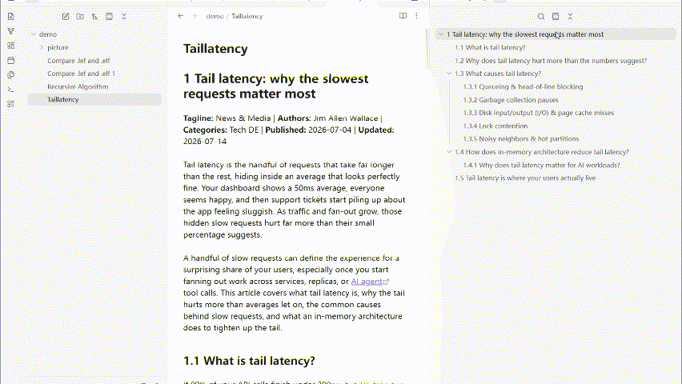
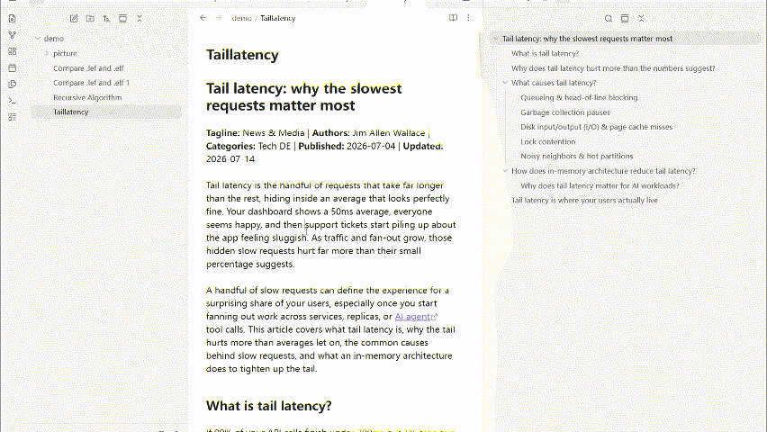
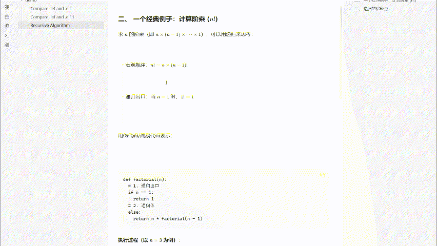
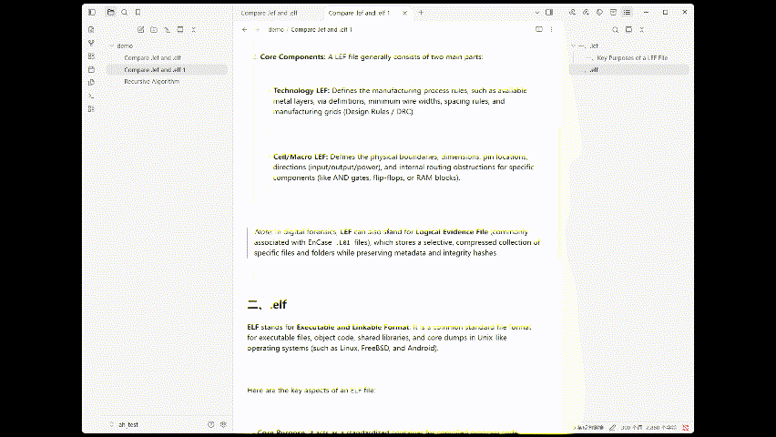
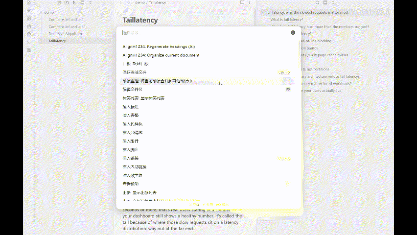
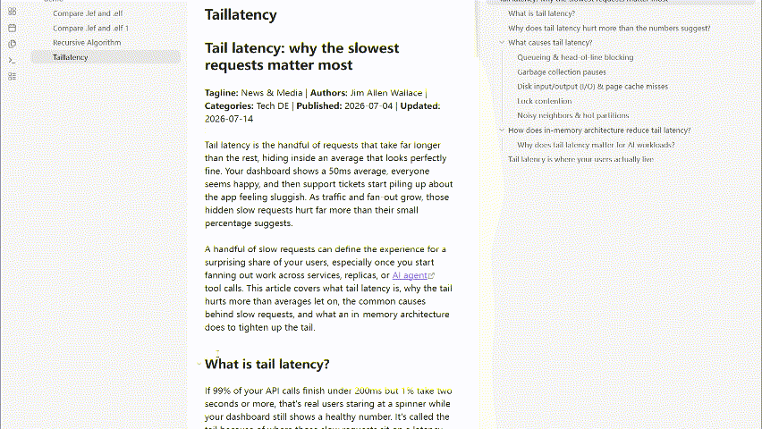

[跳到中文](#中文说明)。 Here is the English version:

# Quick Start

### “Organize current document”

**renumber H1-H4 headings**

**complete code block languages**

**merge blank lines**

### “Regenerate headings (AI)”

### Auto

# note-formatter (Obsidian Plugin)

Organize the current Markdown document with one command: renumber H1-H4 headings, and, according to settings, complete code block languages, merge blank lines, add blank lines at the start and end of blockquotes, and manage horizontal rules. There are also two standalone commands: one calls AI to regenerate headings based on the body text (then automatically organizes the document), and the other inserts a batch of blank lines after the current paragraph.

## Features

- Command “Organize current document”: numbering is always performed; other organizing actions run according to their setting toggles
- Command “Regenerate headings (AI)”: generates “emoji discussion topic: one-sentence summary” based on each section’s body text
- Command “Insert blank lines after this paragraph”: based on the paragraph where the cursor is, inserts N blank lines at the end of the paragraph (N is determined by settings, default 20)
- Auto-organize inserted images (off by default): when the note is saved, move newly added image embeds on this page to `<note directory>/<image folder>/`, rewrite links, and delete the original image (move semantics); supports `![[...]]` and ``; creates the folder automatically if it is missing
- UI language: Chinese / English (switches immediately, including command names; command IDs stay the same, so hotkeys are kept)

### “Organize current document”

- Heading numbering: processes H1-H4 in one pass; H2 restarts from “一” under each H1; H3 resets according to the nearest H2; H4 resets according to the nearest H3
- Numbering mode: Single-level = each level is numbered independently (uses all per-level settings below); Multi-level = `1 ` / `1.1 ` / `1.1.1 ` / `1.1.1.1 ` (fixed Arabic numerals + `.` + space; all levels numbered; missing parent levels default to 1)
- Complete code block languages: recognizes json / yaml / python / bash / sql / html / cpp / c;
- Merge blank lines: compress 3+ consecutive newlines into 1 blank line; no processing inside frontmatter or fenced code blocks
- Add blank lines around blockquotes: add one empty `>` line at the start and end of each `>` quote block (do not add again if an empty `>` already exists; use the indentation of the block’s start/end)
- Horizontal rules: can delete existing horizontal rules (`---` / `***` / `___`), and can insert `---` between two H1 headings or between two H2 headings

### “Regenerate headings (AI)”

- Heading language is decoupled from UI language: follow the document’s main language, or specify one of 11 languages
- For H1-H4, you can separately choose to generate emoji / discussion topic / one-sentence summary (at least one item); the requirements for “one-sentence summary” and “discussion topic” can be customized via “Heading generation prompt” and “Topic generation prompt” respectively
- AI heading generation supports six providers: `claude` / `deepseek` / `gemini` / `gpt` / `qwen` / `kimi`

## Settings

| Setting | Default | Description |
|---|---|---|
| UI language | Chinese | Chinese / English; applies immediately to the settings page and command names (command IDs are unchanged, so hotkeys are kept) |
| Numbering mode | Single-level | Single-level: each level numbered independently; Multi-level: `1 / 1.1 / 1.1.1 / 1.1.1.1` (fixed Arabic numerals + `.` + space; per-level styles/delimiters do not apply) |
| Add space after delimiter | Off | When generating single-level numbering, add one space after the delimiter (automatically skipped for the “space” delimiter and Clear numbering) |
| Numbering system (per level) | Chinese numerals | 12 systems + Clear numbering (does not apply in multi-level mode) |
| Delimiter (per level) | `、` | Used when generating; when recognizing existing numbering, compatible with 13 character delimiters (does not apply in multi-level mode) |
| Complete code block languages | Off | Only add language tags to fenced code blocks that lack a language |
| Merge blank lines | Off | Compress 3+ consecutive newlines into 1 blank line |
| Add blank lines around blockquotes | Off | Add one empty `>` line at the start and end of each `>` quote block (do not add if an empty `>` already exists) |
| Number of blank lines to insert | 20 | Number of lines inserted at once by the “Insert blank lines after this paragraph” command (1-100) |
| Auto-organize inserted images | Off | When the note is saved, move newly added images on this page to the image folder and rewrite links (move, not copy) |
| Image folder | `picture` | Relative to the note’s directory; can be multi-level (`assets/img`); created automatically if it does not exist |
| Delete existing horizontal rules | Off | Delete `---` / `***` / `___`; preserve frontmatter and setext underlines |
| Insert between two H1 headings | Off | Insert `---` before every non-first H1 |
| Insert between two H2 headings | Off | Within each H1 group, insert `---` before the group’s non-first H2; if there is no H1, process the whole document |
| Heading language | Follow document | Follow document (the body script is detected first — Chinese / English / Japanese / Korean / Russian / Arabic, Latin-script languages are split by common words — and the AI is required to use it; if the sample is too short the AI infers it) / Specify language (11 languages: Chinese, English, Japanese, Korean, Spanish, French, German, Portuguese, Russian, Italian, Arabic) |
| H1-H4 generated content | All on | emoji / discussion topic / one-sentence summary; at least one of the three; if all are off, the command reports an error and aborts |
| Heading generation prompt | Chinese default text | Generation requirements for “one-sentence summary”; read-only preview + edit (modal) + reset; if cleared, the default for the current UI language is used (so does a stored default that belongs to the other UI language) |
| Topic generation prompt | Chinese default text | Generation requirements for “discussion topic”; read-only preview + edit (modal) + reset; if cleared, the default for the current UI language is used (so does a stored default that belongs to the other UI language) |
| AI provider | Claude | Six providers: Claude / DeepSeek / Gemini / GPT / Qwen / Kimi; each has a built-in default model |
| API Key | Empty | Used only for “Regenerate headings”; displayed masked with `type=password`; can be cleared; saved in `data.json` |

## Numbering System Limits

| System | Limits |
|---|---|
| Chinese / Arabic / Eastern Arabic | Arabic and Eastern Arabic: `1..999` |
| Roman (uppercase/lowercase) | `1..3999`; falls back to Arabic numerals beyond that |
| Latin (uppercase/lowercase) | Bijective base-26 (A..Z, AA..AB); parsing accepts only 1-2 letters |
| Circled numbers | ①-⑳, ㉑-㉟, ㊱-㊿; 51+ falls back to Arabic numerals |
| Hangul / circled Hangul | 14 each; falls back to Arabic numerals beyond that |
| Cyrillic | Russian alphabet skipping `З` / `О` (31 letters); falls back to Arabic numerals beyond that |
| Katakana | Iroha order, 47 characters; falls back to Arabic numerals beyond that |

# 中文说明

用一个命令整理当前 Markdown 文档：重编号 H1-H4 标题，并按设置补全代码块语言、合并空行、为块引用补首尾空行、管理分割线；另有两个独立命令，分别用于调用 AI 按正文重新生成标题（随后自动整理）、在当前段落之后插入一批空白行。

## 功能

- 命令「整理当前文档」：编号始终执行，其余整理动作按设置开关执行
- 命令「重新生成标题（AI）」：按每节正文生成「emoji 讨论主题：一句话总结」
- 命令「在本段后插入空白行」：以光标所在段落为准，在段末插入 N 个空白行（N 由设置决定，默认 20）
- 自动整理插入图片（默认关）：笔记保存时把本页新增的图片嵌入移动到 `<笔记目录>/<图片文件夹>/`，改写链接并删除原图（移动语义）；支持 `![[...]]` 与 ``，文件夹缺失时自动新建
- 界面语言：中文 / English（设置页即时切换，命令名同步更新；命令 ID 不变，已设置的热键保留）

### 「整理当前文档」

- 标题编号：一次处理 H1-H4；H2 在每个 H1 下从「一」重计，H3 按最近 H2 重置，H4 按最近 H3 重置
- 编号模式：单级 = 每级独立编号（沿用下方所有逐级配置）；多级 = `1 ` / `1.1 ` / `1.1.1 ` / `1.1.1.1 `（固定阿拉伯数字 + `.` + 空格、全补号、缺父级按 1 兜底）
- 补全代码块语言：识别 json / yaml / python / bash / sql / html / cpp / c；
- 合并空行：连续 3+ 个换行压成 1 个空行；frontmatter 与围栏代码块内不处理
- 块引用首尾补空行：每个 `>` 引用段的首尾各补一行空 `>`（已有空 `>` 不重复添加，沿用段首/段尾缩进）
- 分割线：可删除现有分割线（`---` / `***` / `___`），也可在两个 H1 之间或两个 H2 之间插入 `---`

### 「重新生成标题（AI）」

- 标题语言与界面语言解耦：跟随文档主要语言，或从 11 种语言中指定
- H1-H4 可分别选择生成 emoji / 讨论主题 / 一句话总结（至少选一项）；「一句话总结」与「讨论主题」的要求可分别通过「标题生成提示词」「主题生成提示词」自定义
- AI 标题生成支持 `claude` / `deepseek` / `gemini` / `gpt` / `qwen` / `kimi` 六家服务商

## 设置

| 设置项 | 默认值 | 说明 |
|---|---|---|
| 界面语言 | 中文 | 中文 / English；设置页与命令名即时生效（命令 ID 不变，热键保留） |
| 编号模式 | 单级 | 单级：每级独立编号；多级：`1 / 1.1 / 1.1.1 / 1.1.1.1`（固定阿拉伯 + `.` + 空格，各级风格/分隔符不生效） |
| 分隔符后补空格 | 关 | 单级编号生成时在分隔符后加一个空格（「空格」分隔符、清除编号自动跳过） |
| 编号体系（每级） | 中文数字 | 12 种体系 + 清除编号（多级模式不生效） |
| 分隔符（每级） | `、` | 生成时使用；识别旧编号时兼容 13 种字符分隔符（多级模式不生效） |
| 补全代码块语言 | 关 | 只给缺少语言的围栏代码块补标签 |
| 合并空行 | 关 | 连续 3+ 个换行压成 1 个空行 |
| 块引用首尾补空行 | 关 | 每个 `>` 引用段首尾各补一行空 `>`（已有空 `>` 不重复添加） |
| 插入空白行数 | 20 | 命令「在本段后插入空白行」一次插入的行数（1-100） |
| 自动整理插入图片 | 关 | 笔记保存时把本页新增图片移动到图片文件夹并改写链接（移动而非复制） |
| 图片文件夹 | `picture` | 相对笔记所在目录，可多级（`assets/img`）；不存在时自动新建 |
| 删除现有分割线 | 关 | 删除 `---` / `***` / `___`，保留 frontmatter 与 setext 下划线 |
| 两个一级标题之间插入 | 关 | 在每个非首个 H1 之前插入 `---` |
| 两个二级标题之间插入 | 关 | 每个 H1 分组内、该组非首个 H2 之前插入 `---`；无 H1 时按全文处理 |
| 标题语言 | 跟随文档 | 跟随文档（先按正文文字系统判定语言——中/英/日/韩/俄/阿，拉丁字母再按常用词细分西/法/德/葡/意——再要求 AI 用该语言生成；样本太短时交给 AI 判断）/ 指定语言（11 种：中英日韩西法德葡俄意阿） |
| H1-H4 生成内容 | 全开 | emoji / 讨论主题 / 一句话总结，三项至少一项；全关时命令报错并中止 |
| 标题生成提示词 | 中文默认文案 | 对「一句话总结」的生成要求；只读预览 + 修改（弹窗）+ 初始化；清空后按当前界面语言取默认（存的是另一种界面语言的默认文案时同样按当前语言取默认） |
| 主题生成提示词 | 中文默认文案 | 对「讨论主题」的生成要求；只读预览 + 修改（弹窗）+ 初始化；清空后按当前界面语言取默认（存的是另一种界面语言的默认文案时同样按当前语言取默认） |
| AI 服务商 | Claude | 六家：Claude / DeepSeek / Gemini / GPT / Qwen / Kimi；每家内置默认模型 |
| API Key | 空 | 仅用于「重新生成标题」；`type=password` 掩码显示，可清除；保存在 `data.json` |

## 编号体系边界

| 体系 | 边界 |
|---|---|
| 中文 / 阿拉伯 / 东阿拉伯 | 阿拉伯与东阿拉伯 `1..999` |
| 罗马（大/小写） | `1..3999`，超出回退阿拉伯数字 |
| 拉丁（大/小写） | 双射 26 进制（A..Z、AA..AB）；解析只接受 1-2 个字母 |
| 圈号 | ①-⑳、㉑-㉟、㊱-㊿；51+ 回退阿拉伯 |
| 谚文 / 带圈谚文 | 各 14 个；超出回退阿拉伯 |
| 西里尔 | 俄语字母表跳 `З` / `О`（31 个）；超出回退阿拉伯 |
| 片假名 | 伊吕波顺 47 字；超出回退阿拉伯 |
